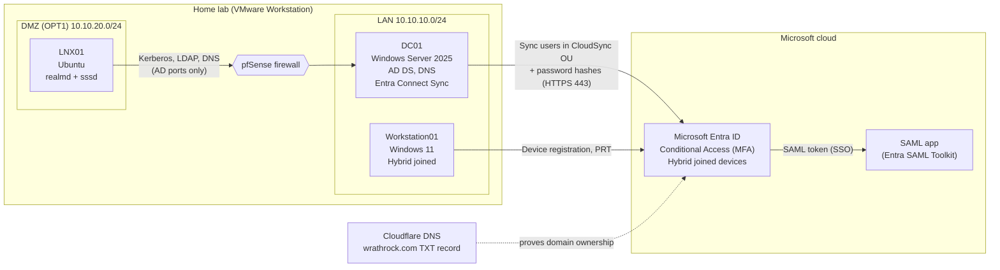

# Lab 1: Hybrid Identity with Microsoft Entra ID

Connecting an on-premises Active Directory to Microsoft Entra ID, securely, the way a mid-size company would: synced users, hybrid joined devices, MFA through Conditional Access, single sign-on to a SaaS app, a tested joiner and leaver process, and a Linux server in a DMZ joined to the same domain.

**Status:** complete · **Time:** about 8 hours over two days · **Cloud cost:** under 2 USD a month (budget capped at 20 USD)

## The problem

A company runs Active Directory on-prem and is moving to Microsoft 365 and SaaS apps. Users should have one account and one password everywhere, sign in once, and be protected by MFA. When someone leaves, disabling them in one place should cut off access everywhere. Admin accounts must not become an easy target in the cloud.

## Architecture

## What was built

| Area | What was done | Proof |
|---|---|---|
| Identity sync | Entra Connect Sync with password hash sync, filtered to one OU, users sign in as `user@wrathrock.com` | [Verification](build-guide.md#verification) |
| Device identity | Workstation01 hybrid joined (TPM-protected key), user gets a Primary Refresh Token for SSO | [Part 4](build-guide.md#part-4-hybrid-joining-workstation01) |
| Access control | Three Conditional Access policies: MFA for a pilot group, MFA for admins, block legacy authentication. Break-glass account excluded | [Part 5](build-guide.md#part-5-conditional-access) |
| Lifecycle | Joiner appeared in Entra after the next sync cycle; leaver blocked from new cloud sign-ins after disable and sync | [Part 6](build-guide.md#part-6-lifecycle-test) |
| Single sign-on | SAML SSO to a test SaaS app; signed in from the hybrid joined PC with no password prompt | [Part 8](build-guide.md#part-8-single-sign-on-sso-to-an-app) |
| Linux | Ubuntu server in a DMZ joined to AD with realmd and sssd, through a firewall rule limited to AD ports | [Part 9](build-guide.md#part-9-join-lnx01-ubuntu-to-lablocal) |

## Design decisions

Twelve short Architecture Decision Records explain why each choice was made, what else was considered, and what it costs. Start with the [index](adr/README.md). A few highlights:

- [Password hash sync over pass-through or federation](adr/ADR-002-password-hash-sync-for-cloud-sign-in.md): cloud sign-in survives an on-prem outage.
- [Sync only one OU](adr/ADR-004-sync-only-the-cloudsync-ou.md): admin and service accounts never reach the cloud.
- [Narrow DMZ firewall exception](adr/ADR-010-narrow-firewall-exception-for-lnx01-instead.md): the Linux server can reach the DC on AD ports only.

## Problems solved along the way

| Symptom | Root cause | Fix |
|---|---|---|
| Entra Connect: "could not configure application-based authentication" | AADSTS700027: DC01 was on the wrong time zone, so its certificate was dated an hour in the future | Correct time zone, internet time source on the PDC |
| Linux: `realm discover` finds no domain | DNS pointed at the firewall, which doesn't know `lab.local` | Netplan override to use the DC for DNS |
| Linux: every AD port timed out | DMZ rule blocking the internal network, by design | One pass rule above it, AD ports only |
| Linux: password accepted, login refused | sssd couldn't complete the GPO logon-rights check | `ad_gpo_access_control = permissive` (lab only, see ADR-011) |
| Sign-in log said "Not applied" | Policy was in report-only and logs lag | Check after switching policy On |

## Lessons learned

- **Clocks matter.** Certificates and Kerberos both fail when time drifts; a one-hour error is almost always a time zone.
- **"Authentication success" and "access allowed" are separate checks.** Reading the logs line by line showed which one failed.
- **A DMZ is supposed to block.** The right fix was a narrow exception, not a weaker zone.
- **Disabling a user isn't instant in the cloud.** New sign-ins stop after sync; existing sessions need Revoke sessions.

## Skills shown

Microsoft Entra ID · Entra Connect Sync · Conditional Access · SAML SSO · Hybrid join · Active Directory · DNS · Kerberos · pfSense firewall rules · Ubuntu (realmd, sssd, netplan) · PowerShell · Bash · log-based troubleshooting · cost control

## Repository contents

| Path | What's in it |
|---|---|
| [build-guide.md](build-guide.md) | Every step, in order, with what it's for and why (31 screenshots) |
| [adr/](adr/) | One file per design decision |
| [scripts/](scripts/) | The PowerShell and Bash commands, grouped by part |
| [screenshots/](screenshots/) | Evidence, with IDs and personal data blurred |

## Next steps

- Deploy an app to Workstation01 with Microsoft Intune (device and app management)
- Compare Entra Cloud Sync with Connect Sync
- Linux logon rights enforced through GPO instead of permissive mode
