# Lab 1: Hybrid Identity, Build Guide

Every step of the lab, in order, with what each step is for and why it was done. Commands can be copied as they are; the same commands are collected in [`scripts/`](scripts/).

> Sensitive values are replaced with placeholders: the tenant is shown as `contoso.onmicrosoft.com`, and IDs, the public IP address and the SAML connection number are blurred in screenshots.

**Contents:** [At a glance](#at-a-glance) · [Key terms](#key-terms-in-plain-words) · [Lab environment](#lab-environment) · [Part 1](#part-1-cloud-preparation) · [Part 2](#part-2-on-prem-preparation) · [Part 3](#part-3-installing-entra-connect-sync) · [Troubleshooting](#troubleshooting-certificate-rejected-because-the-clock-was-one-hour-fast) · [Verification](#verification) · [Part 4](#part-4-hybrid-joining-workstation01) · [Part 5](#part-5-conditional-access) · [Part 6](#part-6-lifecycle-test) · [Part 7](#part-7-clean-up) · [Part 8](#part-8-single-sign-on-sso-to-an-app) · [Part 9](#part-9-join-lnx01-ubuntu-to-lablocal)

## At a glance

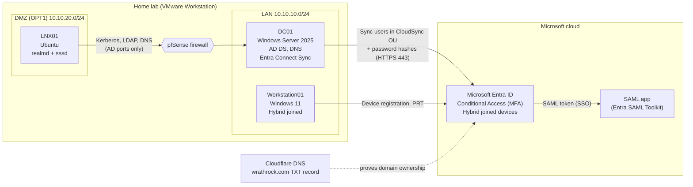

Entra Connect on DC01 reads only the CloudSync OU and sends those users and their password hashes to Entra ID. The Cloudflare TXT record is what let Entra accept wrathrock.com logins. Workstation01 is hybrid joined, so signing in to Windows also signs the user in to cloud apps. LNX01 sits in a DMZ and reaches DC01 through one narrow firewall rule.

## Key terms in plain words

| Term | What it means |
| --- | --- |
| Active Directory (AD) | The on-prem user and computer directory running on DC01. It holds the lab.local domain. |
| Microsoft Entra ID | Microsoft's cloud directory, formerly Azure AD. Every Microsoft 365 and Azure sign-in goes through it. |
| Tenant | Your own private copy of Entra ID. In this guide it is shown as contoso.onmicrosoft.com. |
| Hybrid identity | One user account that works both on-prem and in the cloud, with the same name and password. |
| Entra Connect Sync | The program on DC01 that copies users from AD up to Entra ID every 30 minutes. |
| Password hash sync (PHS) | Entra Connect sends a scrambled, one-way hash of each password to the cloud, so users sign in to the cloud with their on-prem password. The real password never leaves DC01. |
| UPN (user principal name) | The login name in email format, for example tuser1@wrathrock.com. |
| UPN suffix | The part after the @. lab.local can't be used in the cloud, so wrathrock.com was added. |
| OU (organizational unit) | A folder inside AD. The CloudSync OU holds only the accounts we want in the cloud. |
| Break-glass account | A cloud-only emergency admin, kept out of every policy, used only if you get locked out. |
| TXT record | A public text note on a domain's DNS. Used here to prove you own wrathrock.com. |
| Application-based authentication (ABA) | Newer Entra Connect versions sign in to Entra with a certificate instead of a stored password. |
| Tier 0 | The most sensitive systems in a company, like domain controllers and the sync server. They get the strictest protection. |


## Lab environment

Everything on-prem runs as VMware Workstation VMs on a desktop with 64 GB of RAM, behind a pfSense firewall.

| Component | What it is | Role in Lab 1 |
| --- | --- | --- |
| pfSense-FW | Firewall VM | Separates the lab networks and lets DC01 reach Microsoft over HTTPS (port 443) and NTP (port 123) |
| DC01 | Windows Server 2025 domain controller for lab.local (NetBIOS name LAB) | Holds the users, and now also runs Entra Connect Sync |
| SQL01 | SQL Server VM | Not used in Lab 1. Used later in Lab 3 |
| LNX01 | Ubuntu Server VM in the DMZ (OPT1) | Joined to lab.local as a Linux domain member (Part 9) |
| Workstation01 | Windows 11 VM | Hybrid joined to Entra ID (Part 4) |
| Entra ID tenant | contoso.onmicrosoft.com, with Entra ID P2 | The cloud side of the hybrid setup |
| Azure subscription | Azure subscription 1 | Billing and the budget alert. No Azure resources are needed for Lab 1 |
| wrathrock.com | Domain registered and managed in Cloudflare | Becomes the login suffix users sign in with |
## Part 1: Cloud preparation

### Step 1: Budget alert

**Why:** Azure bills by the hour for many services. A budget alert emails you before costs creep up. It only warns you. It does not stop spending.

**How:**

1. Azure portal, then **Cost Management**, then **Budgets**, then **+ Add**.
2. Scope: Azure subscription 1. Name: `lab-monthly-budget`. Reset period: Monthly. Amount: 20 USD.
3. Alert conditions, all type **Actual**, at 50%, 80% and 100%, sent to your email.

**Result:** The budget is in place. Existing storage accounts cost about 2 USD a month and were kept on purpose.

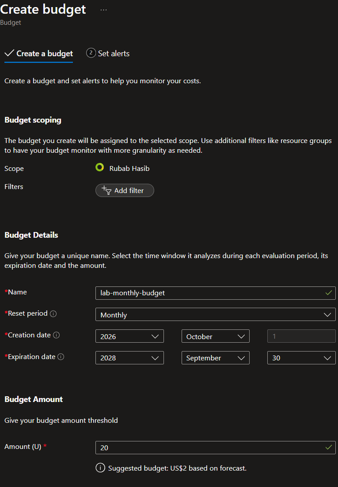

*Figure 1. The budget form. Name lab-monthly-budget, reset Monthly, amount 20. The chart on the right (not shown) confirmed the lab was costing about 2 USD a month.*

**Cost rule for the lab:** avoid anything billed around the clock, like a VPN Gateway, Azure Firewall, Bastion, or VMs left running.

### Step 2: Break-glass admin account

**Why:** Later steps add Conditional Access and MFA rules, which can lock every admin out if one is wrong. A synced admin also depends on DC01 being up. A cloud-only emergency account avoids both problems.

**How:**

1. Entra admin center, then **Users**, then **New user**, then **Create new user**.
2. User principal name: `breakglass@contoso.onmicrosoft.com`. Display name: Break Glass Admin. A long password of 20 or more characters, saved in a password manager.
3. **Assignments** tab: add the **Global Administrator** role.
4. Sign in once in a private window and register MFA, which Microsoft now requires for admin portals.

**Rules to follow:** use it only in emergencies, exclude it from every Conditional Access policy, and alert on any sign-in with it.

### Step 3: Verify wrathrock.com in Entra

**Why:** The users' on-prem logins ended in lab.local. A .local domain isn't a real internet domain, so Entra can't sync logins on it. Entra only accepts login names on a domain you prove you own.

**How:**

1. Entra admin center, then **Entra ID**, then **Domain names**, then **+ Add custom domain**, and enter `wrathrock.com`.
2. Entra shows a TXT record. Here it was `MS=ms00000000`.
3. In Cloudflare, under wrathrock.com, go to **DNS**, then **Records**, then **Add record**: Type TXT, Name `@`, Content `MS=ms00000000`, TTL Auto.
4. Check the record is live: `nslookup -type=TXT wrathrock.com 1.1.1.1`
5. Back in Entra, click **Verify**.

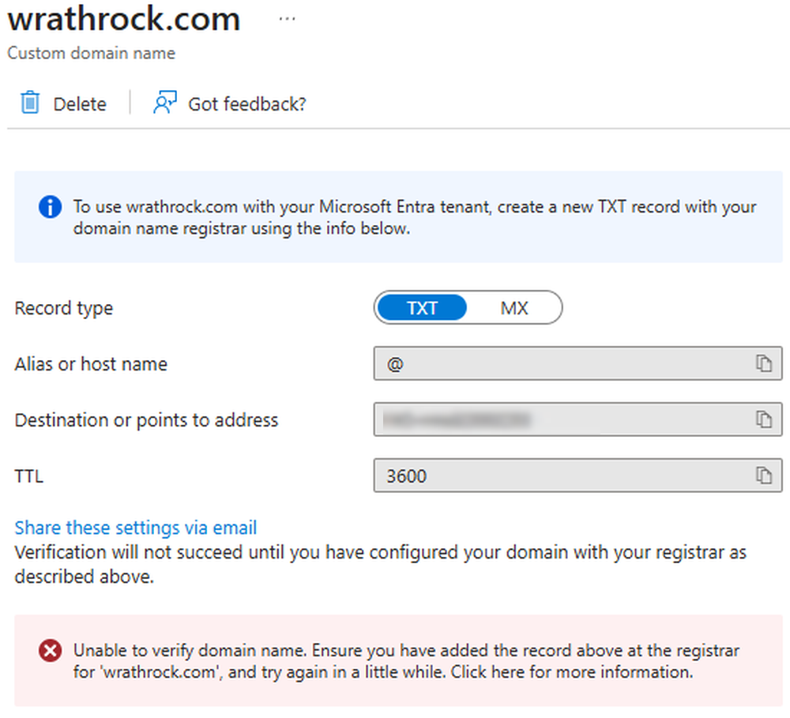

*Figure 2. The TXT record Entra asked for: host @, value MS=ms00000000, TTL 3600. The red banner is from the first Verify click, before Cloudflare had published the record. It verified on the next try.*

**What this actually did:** Microsoft looked up wrathrock.com's public DNS and found its own random code there. Only the domain owner can add DNS records, so that proves ownership. The record sends no traffic anywhere, so the n8n tunnel and everything else on wrathrock.com is unaffected.

**Result:** wrathrock.com shows as **Verified**. It was not made the primary domain, and no MX or email records were added.


## Part 2: On-prem preparation

All commands run in PowerShell ISE as administrator on DC01.

### Step 4: Check the domain name

```powershell
Get-ADDomain | Select-Object DNSRoot, NetBIOSName
Get-ADForest | Select-Object -ExpandProperty UPNSuffixes
```

**Result:** domain `lab.local`, NetBIOS name `LAB`, and no extra UPN suffixes. This confirmed we needed wrathrock.com as a suffix.

### Step 5: Add the suffix, a CloudSync OU and two test users

**Why a separate OU:** Entra Connect will only sync this OU. Admin and service accounts stay out of the cloud. If a cloud account is ever compromised, an attacker can't use it to reach the on-prem domain, and the reverse is also true. That's least privilege.

```powershell
# Add wrathrock.com as a login suffix
Get-ADForest | Set-ADForest -UPNSuffixes @{Add="wrathrock.com"}

# OU that holds only the accounts we sync
New-ADOrganizationalUnit -Name "CloudSync" -Path "DC=lab,DC=local"

# Two test users with wrathrock.com logins
$pw = Read-Host "Password for test users" -AsSecureString
New-ADUser -Name "Test User1" -GivenName "Test" -Surname "User1" `
  -SamAccountName "tuser1" -UserPrincipalName "tuser1@wrathrock.com" `
  -Path "OU=CloudSync,DC=lab,DC=local" -AccountPassword $pw -Enabled $true
New-ADUser -Name "Test User2" -GivenName "Test" -Surname "User2" `
  -SamAccountName "tuser2" -UserPrincipalName "tuser2@wrathrock.com" `
  -Path "OU=CloudSync,DC=lab,DC=local" -AccountPassword $pw -Enabled $true

# Check
Get-ADUser -SearchBase "OU=CloudSync,DC=lab,DC=local" -Filter * |
  Select-Object Name, UserPrincipalName, Enabled
```

**Result:** Test User1 (tuser1@wrathrock.com) and Test User2 (tuser2@wrathrock.com), both enabled.

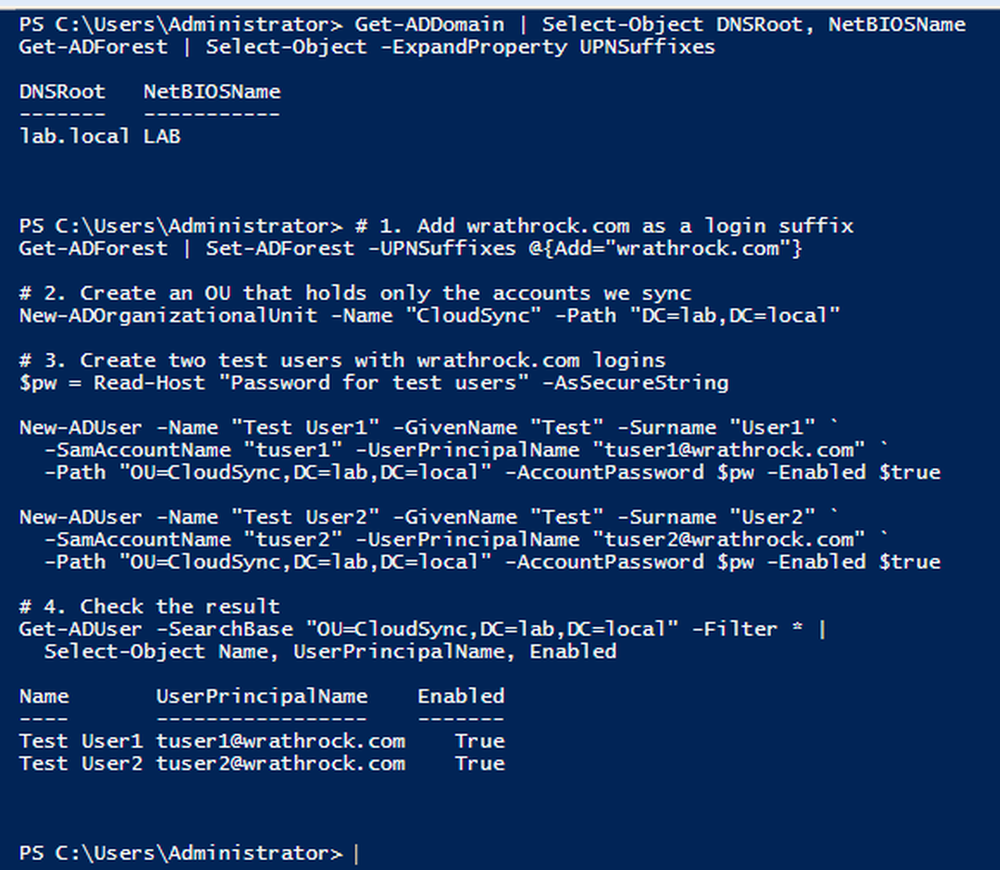

*Figure 3. The on-prem prep in one run: domain check (lab.local, LAB), the wrathrock.com suffix, the CloudSync OU, and the two test users. The final table proves both users exist with @wrathrock.com logins and are enabled.*

### Step 6: Pre-flight checks

```powershell
# Can DC01 reach Microsoft sign-in through pfSense?
Resolve-DnsName login.microsoftonline.com | Select-Object -First 1
Test-NetConnection login.microsoftonline.com -Port 443 | Select-Object ComputerName, TcpTestSucceeded

# Entra Connect runs signed scripts during install
Set-ExecutionPolicy RemoteSigned -Scope LocalMachine -Force

# .NET version (528040 or higher is 4.8)
(Get-ItemProperty "HKLM:\SOFTWARE\Microsoft\NET Framework Setup\NDP\v4\Full").Release

# AD Recycle Bin, recommended by Microsoft. Can't be turned off later.
Enable-ADOptionalFeature "Recycle Bin Feature" -Scope ForestOrConfigurationSet -Target "lab.local" -Confirm:$false
```

| Check | Result |
| --- | --- |
| DNS for login.microsoftonline.com | Resolves |
| HTTPS to Microsoft (port 443) | TcpTestSucceeded: True |
| Execution policy | RemoteSigned |
| .NET release | 533509, which is 4.8.1 |
| AD Recycle Bin | Enabled. The orange text is only a warning that it can't be undone |


## Part 3: Installing Entra Connect Sync

### Step 7: Download

On DC01: Entra admin center, then **Entra ID**, then **Entra Connect**, then **Get started**, then **Manage**, then **Download Connect Sync Agent**. This downloads `AzureADConnect.msi`. Microsoft now hosts the download in the admin center, and a fresh download is the latest version, which is 2.6.84 or newer.

**Where it's installed:** Microsoft supports installing on a domain controller, but recommends a separate member server, treated as Tier 0. The lab uses DC01 to save RAM. In production you'd use a dedicated, locked-down server.

### Step 8: Run the wizard with custom settings

**Why not Express:** Express syncs every user in the domain. Custom settings let us sync only the CloudSync OU.

| Wizard screen | Setting chosen | Why |
| --- | --- | --- |
| Express settings | **Customize** | To filter by OU |
| Install required components | All boxes left unticked | Uses the built-in local database, which is fine for a lab |
| User sign-in | **Password Hash Synchronization**. Enable single sign-on left unticked | Cloud sign-in keeps working when DC01 is off. Hybrid join will provide SSO later |
| Connect to Microsoft Entra ID | Signed in as admin@contoso.onmicrosoft.com with MFA | Needs Global Admin or Hybrid Identity Administrator |
| Connect your directories | Forest lab.local, **Create new AD account** with LAB\\Administrator | The wizard creates its own low-privilege account for reading AD |
| Microsoft Entra sign-in | UPN attribute: userPrincipalName. Ticked **Continue without matching all UPN suffixes** | wrathrock.com is Verified. lab.local can never be |
| Domain and OU filtering | **Sync selected domains and OUs**, only **CloudSync** ticked | Keeps admin and service accounts out of the cloud |
| Identifying users | Defaults. Let Azure manage the source anchor | Standard for a single forest |
| Filtering | Synchronize all users and devices | The OU filter already limits the scope |
| Optional features | Only password hash sync | Nothing else needed yet |
| Ready to configure | Start sync ticked. Staging mode unticked | Staging mode is for a standby server |

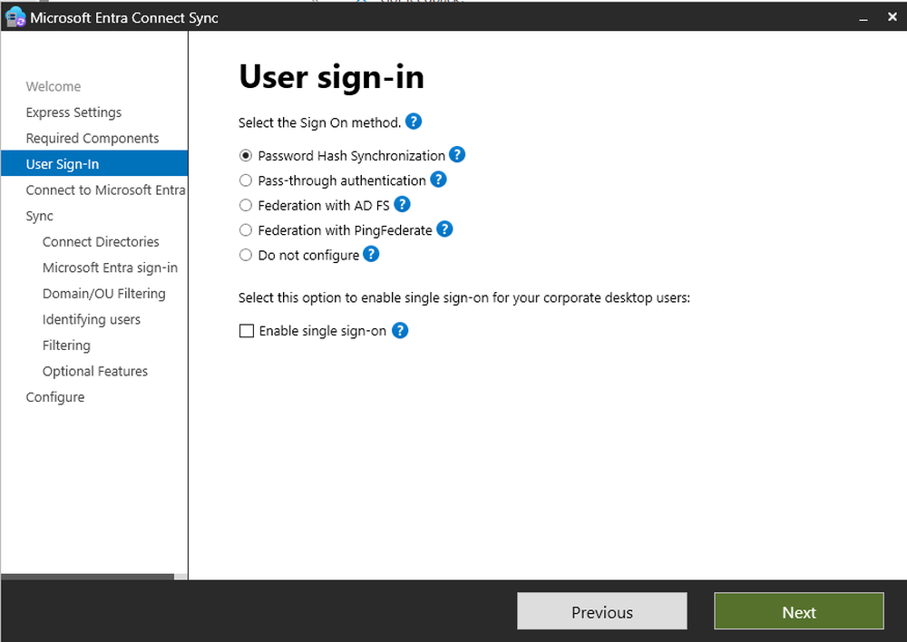

*Figure 4. User sign-in page of the wizard. Password Hash Synchronization is selected and Enable single sign-on is left unticked, because hybrid join gives SSO the modern way.*

**Built-in safety net:** the Export Deletion Threshold of 500 stops a sync if it would delete more than 500 cloud objects at once, for example after someone deletes an OU by mistake.


## Troubleshooting: certificate rejected because the clock was one hour fast

The first install failed because DC01's clock was one hour ahead. Fixing the time zone and time source let the install finish.

**Symptom:** at the Configure stage the wizard stopped with: *"Microsoft Entra Connect could not configure application-based authentication for this server. Setup cannot continue."*

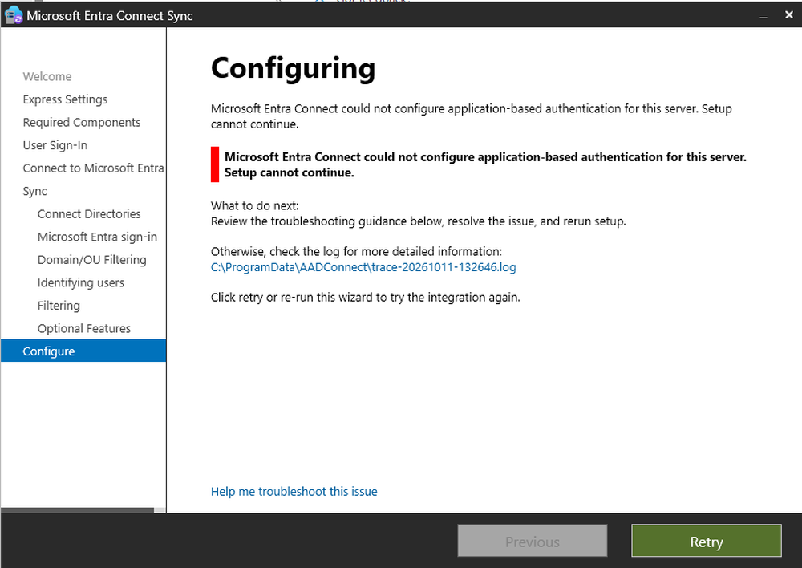

*Figure 5. The failure. Note the log path in the middle; that file is where the real cause was found.*

**Background:** recent versions of Entra Connect sign in to Entra with a certificate. Version 2.6.84 deliberately stops if that fails, where older versions quietly fell back to a stored password.

**Investigation, step by step:**

1. Searched the setup log for errors:

```powershell
Select-String -Path "C:\ProgramData\AADConnect\trace-20261011-132646.log" `
  -Pattern "error|exception|fail" | Select-Object -Last 25
```

The failure was in `AcquireTokenWithCertificate`. The certificate existed, but Entra rejected the sign-in.

2. Searched the same log for Entra's exact error code:

```powershell
Select-String -Path "C:\ProgramData\AADConnect\trace-20261011-132646.log" `
  -Pattern "AADSTS" | Select-Object -Last 5
```

It returned **AADSTS700027**: the key was *"expired"*, with the key valid from **20:38:20** UTC but used at **19:38:51** UTC. The certificate was one hour in the future.

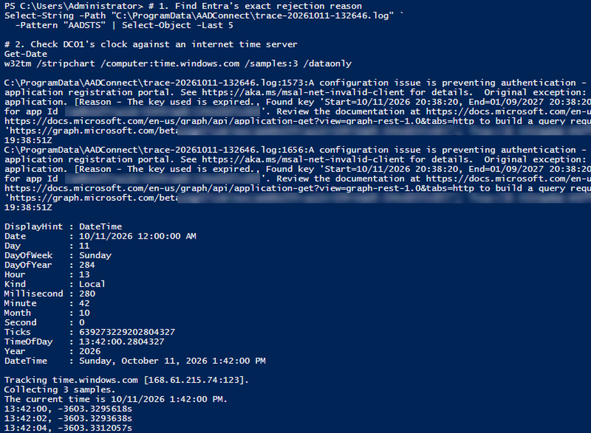

*Figure 6. The evidence. The log says the key starts at 20:38:20 but was used at 19:38:51 (both UTC). The stripchart at the bottom shows DC01 about -3603 seconds off time.windows.com, which is one hour ahead.*

3. Compared DC01's clock with Microsoft's time server:

```powershell
w32tm /stripchart /computer:time.windows.com /samples:3 /dataonly
```

The offset was **-3603 seconds**, about one hour, and the minus sign means DC01 was ahead.

**Root cause:** DC01's time zone was **Pacific Time**. The clock face showed Calgary's time, but the real time underneath was an hour ahead. Every certificate DC01 created was stamped an hour into the future, so Microsoft treated it as not valid yet.

**Fix:**

```powershell
Set-TimeZone -Id "Mountain Standard Time"   # Mountain Time with daylight saving
w32tm /config /manualpeerlist:"time.windows.com,0x8" /syncfromflags:manual /reliable:yes /update
Restart-Service w32time
w32tm /resync /force
w32tm /stripchart /computer:time.windows.com /samples:3 /dataonly   # offset now about 0
```

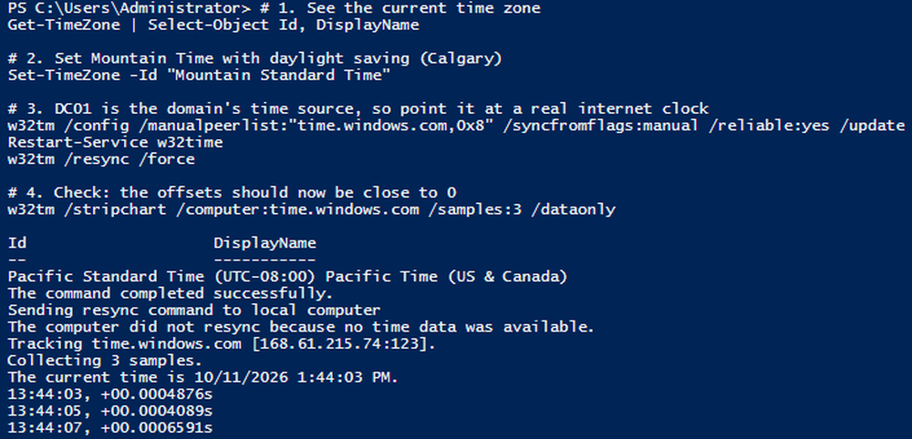

*Figure 7. The fix. Get-TimeZone shows Pacific Standard Time was the cause. After the commands, the stripchart offsets drop to about +0.0004 seconds.*

DC01 is the domain's time source, which is why it points at an internet clock. After the fix the offset was +0.0004 seconds, and **Retry** in the wizard completed the configuration.

**Lesson:** when an error mentions times, compare them with each other and with the real clock. A gap of exactly one hour almost always means a time zone or daylight saving problem.

**Follow-up:** check `Get-TimeZone` on SQL01 and Workstation01 as well.


## Verification

All five checks passed, including the end-to-end sign-in as tuser1, which reached the My Apps page.

| Check | Where | Expected | Result |
| --- | --- | --- | --- |
| Test users appear in the cloud | Entra admin center, Users | tuser1 and tuser2 with @wrathrock.com, On-premises sync: Yes | Passed |
| Only the CloudSync OU syncs | Entra admin center, Users | Every other account shows On-premises sync: No, and lab.local Administrator is absent | Passed |
| Sync is healthy | Entra ID, Entra Connect, Connect Sync | Sync status Enabled, Password Hash Sync Enabled, recent last sync | Passed |
| Sync schedule | PowerShell on DC01 | SyncCycleEnabled True, 30 minute interval | Passed. SyncCycleEnabled True, interval 00:30:00 |
| Synced user can sign in | myapps.microsoft.com in a private window as tuser1@wrathrock.com | Signs in with the on-prem password | Passed. Password reset on-prem, synced within minutes, and Entra prompted for MFA setup |

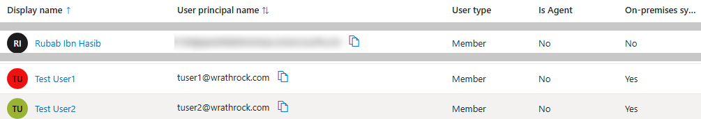

*Figure 8. Users list in Entra. Test User1 and Test User2 show On-premises sync **Yes**; the cloud-only admin shows **No**. That is the OU filter working.*

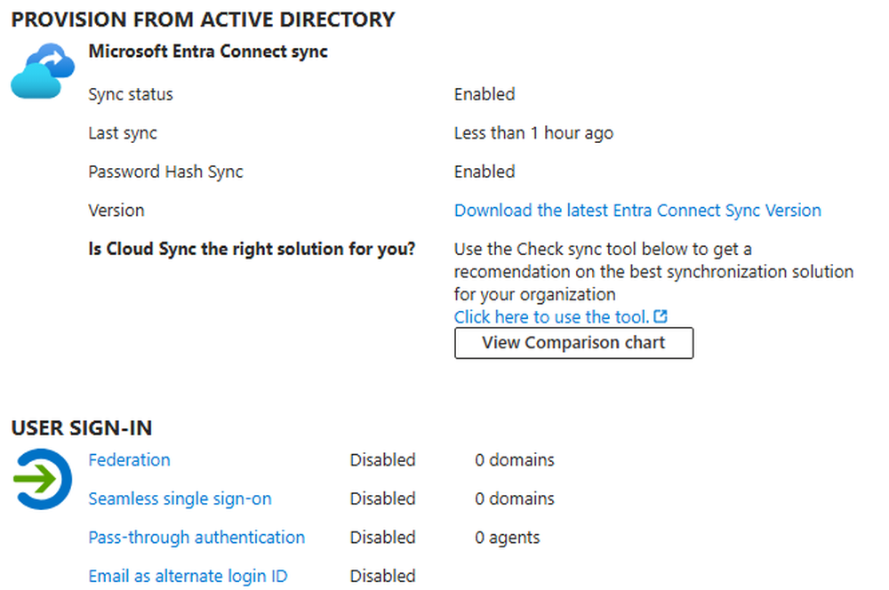

*Figure 9. Connect Sync status in the portal: Sync status Enabled, last sync less than an hour ago, Password Hash Sync Enabled, and federation, seamless SSO and pass-through all Disabled as designed.*

Command for the schedule check. Open a **new** PowerShell window first, because one opened before the install doesn't know the new commands:

```powershell
Import-Module ADSync
Get-ADSyncScheduler | Select-Object SyncCycleEnabled, CurrentlyEffectiveSyncCycleInterval, NextSyncCycleStartTimeInUTC
```

Force a sync any time with `Start-ADSyncSyncCycle -PolicyType Delta`.

**Sign-in test notes:** the original tuser1 password was typed into a hidden Read-Host prompt, so it was reset with the command below. Password changes sync on their own about every 2 minutes, separately from the 30 minute user sync.

```powershell
Set-ADAccountPassword -Identity "tuser1" -Reset `
  -NewPassword (Read-Host "New password for tuser1" -AsSecureString)
```

The MFA prompt on first sign-in comes from Microsoft's mandatory MFA rollout. It shows Entra accepted the on-prem password.


## Part 4: Hybrid joining Workstation01

**What hybrid join means:** the PC belongs to lab.local and is also registered in Entra ID. Conditional Access can then trust the device, and users get automatic sign-in to cloud apps when they log in to Windows.

### Step 11: Move the computer account into the synced OU

```powershell
Get-ADComputer -Filter * | Select-Object Name, DistinguishedName
Get-ADComputer "WORKSTATION01" | Move-ADObject -TargetPath "OU=CloudSync,DC=lab,DC=local"
```

Entra Connect only syncs the CloudSync OU, so the computer must be there too.

### Step 12: Turn on hybrid join in Entra Connect

Open the wizard at `C:\Program Files\Microsoft Azure Active Directory Connect\AzureADConnect.exe`. The folder keeps the old Azure AD name, so searching for "Entra Connect" only finds the Synchronization Service.

**Configure**, then **Configure device options**, then **Configure Microsoft Entra hybrid join**, then **Windows 10 or later domain-joined devices**. On the SCP page, tick lab.local, choose Microsoft Entra ID as the authentication service, and add LAB\\Administrator as Enterprise Admin.

This writes a Service Connection Point (SCP) into AD, a small pointer that tells domain PCs which Entra tenant to register with.

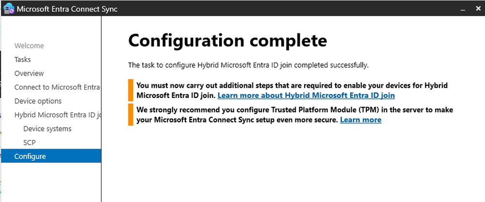

*Figure 10. The hybrid join task finished. The orange notes are standard reminders; the extra step they mention is the SCP and sync that Step 13 covers.*

Don't edit connector properties in the Synchronization Service Manager. Microsoft warns that even clicking OK there can clear the certificate settings.

### Step 13: Complete the join

With password hash sync, the join works in three parts, known as sync-join:

1. The join task on Workstation01 writes a certificate onto its own AD computer account.
2. Entra Connect syncs that computer account to Entra, which shows the device as **Pending**.
3. The next time the task runs, for example after a restart, Entra recognizes the device and the join completes.

```powershell
# On Workstation01 (admin)
Set-TimeZone -Id "Mountain Standard Time"
schtasks /run /tn "\Microsoft\Windows\Workplace Join\Automatic-Device-Join"
dsregcmd /status

# On DC01
Get-ADComputer WORKSTATION01 -Properties userCertificate |
  Select-Object Name, @{n='Certificates';e={$_.userCertificate.Count}}
Start-ADSyncSyncCycle -PolicyType Delta
```

The first `dsregcmd /status` showed `error_missing_device` ("the device object is not found"). That's normal before step 2. After the sync and a restart, it showed **AzureAdJoined: YES**, **DomainJoined: YES**, **DeviceAuthStatus: SUCCESS** and **TpmProtected: YES**.

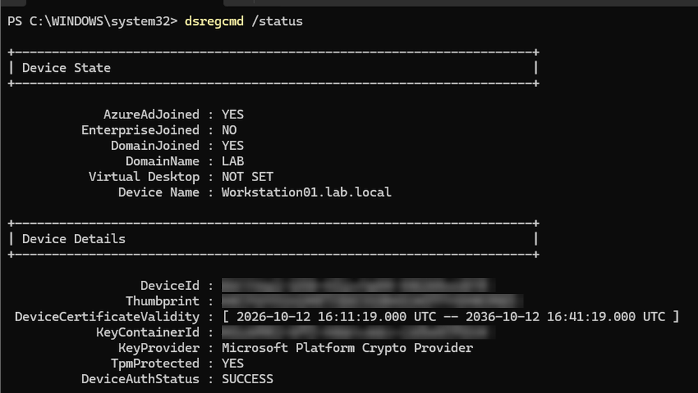

*Figure 11. dsregcmd /status on Workstation01. Check Device Name first (Workstation01.lab.local), then AzureAdJoined YES, DomainJoined YES, TpmProtected YES and DeviceAuthStatus SUCCESS.*

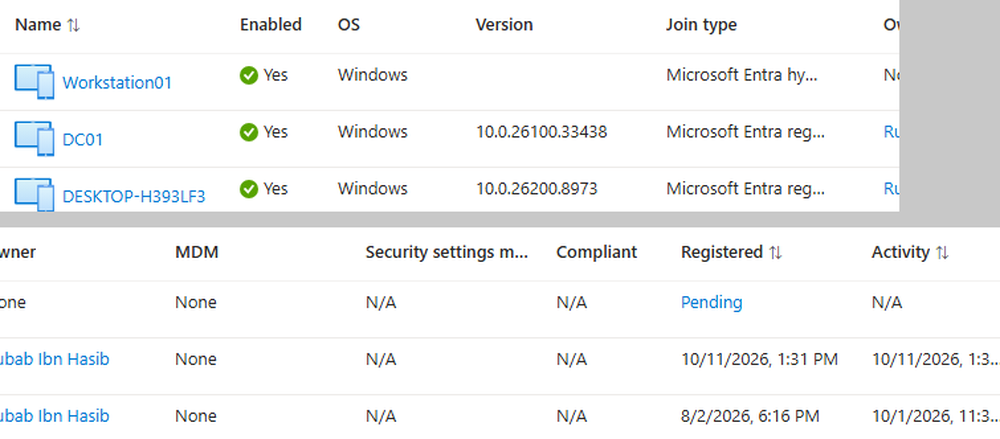

*Figure 12. Entra Devices list. Workstation01 shows join type Microsoft Entra hybrid joined. Registered says Pending until the PC finishes its side after a restart. DC01 in this list was removed later in Step 25.*

**Tip:** `dsregcmd /status` shows how a PC is connected to Entra. Always check its **Device Name** line, because it's easy to run it on the wrong VM. It also failed the same way on DC01, and that's expected, because domain controllers can't be hybrid joined.

**SSO test:** signed in to Workstation01 as LAB\\tuser1, the synced user. `dsregcmd /status` showed **AzureAdPrt: YES**. The user got a Primary Refresh Token, the cloud sign-in token that gives automatic sign-in to Microsoft 365 and Entra apps, just by logging in to Windows. The admin account LAB\\Administrator doesn't get one, because it isn't synced. In Entra Devices, Workstation01's Registered column should change from Pending to a date once the join completes.


## Part 5: Conditional Access

**Licensing note:** the tenant has one Entra ID P2 licence, assigned to the admin account. Conditional Access switches on for the whole tenant once it has P1 or P2, so the lab policies work. But Microsoft's rule is that **every user a policy protects needs P1 or P2**. Creating policies only needs an admin role. In production, tuser1 and tuser2 would each need a licence. The lab leaves this as is, by design.

**Rollout plan:** pilot group first, then Report-only, then On, then widen to All users with the break-glass account excluded. Turning a new policy on for everyone at once is the classic way to lock out a whole company.

### Step 16: Pilot group

Entra admin center, then **Groups**, then **New group**: Security group `CA-Lab-MFA-Users`, membership Assigned, members Test User1 and Test User2. Policies target groups, so adding or removing people never means editing the policy. The break-glass account is never added.

### Step 17: Policy CA001 in Report-only

| Setting | Value |
| --- | --- |
| Name | CA001-Require-MFA-Lab-Users |
| Users, include | CA-Lab-MFA-Users |
| Users, exclude | Break Glass Admin. It's not in the group, but excluding it here keeps it safe when the policy widens to All users |
| Target resources | All resources |
| Conditions | None |
| Grant | Grant access, require multifactor authentication |
| State | **Report-only**. It logs what would happen without blocking anyone |

**Only Entra sign-ins are covered.** On-prem users who aren't synced don't exist in Entra, so their domain and file share access stays under AD and Group Policy.

### Step 18: Test with the What If tool

User **Test User1**, target **Office 365 Exchange Online**, platform **Windows**, client **Browser**: CA001 is listed under **Policies that will apply**, requiring multifactor authentication. User **Break Glass Admin** with the same settings: 0 policies apply. The pilot group is covered and the emergency account is not.

### Step 19: Turn off security defaults, then turn CA001 On

Saving CA001 as On failed with *"Security defaults must be disabled to enable Conditional Access policy."* Security defaults are Microsoft's free, all-or-nothing baseline: MFA for everyone and legacy sign-in blocked. They can't run alongside Conditional Access.

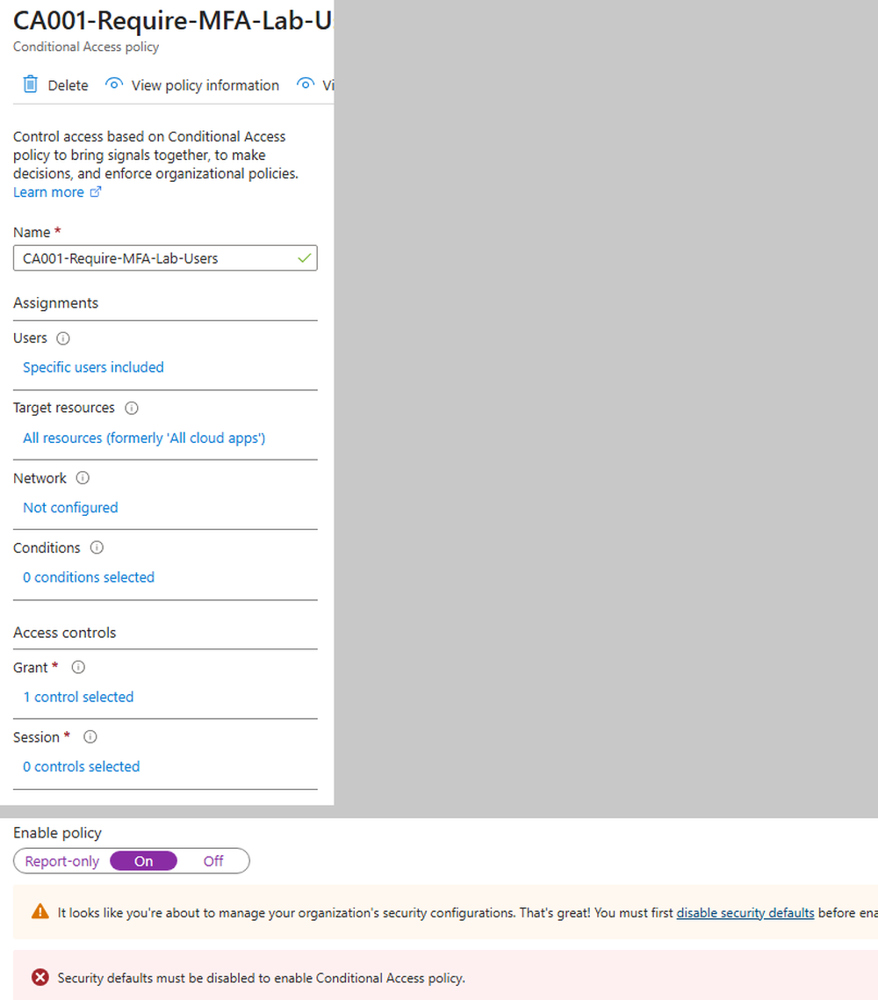

*Figure 13. CA001 set to On, and the error that blocked saving until security defaults were turned off.*

Disabled them under **Entra ID**, then **Overview**, then **Properties**, then **Manage security defaults**, with the reason *My organization is planning to use Conditional Access*, then set CA001 to **On**.

**Risk:** turning off security defaults removes the blanket protection from every user, not just the pilot group. It's replaced straight away by baseline policies: CA002, MFA for admin roles, and CA003, block legacy authentication, both excluding break-glass. Microsoft's mandatory MFA for admin portals still applies in the meantime.

### Steps 20 and 21: Baseline policies CA002 and CA003

Both were created from Microsoft's **Secure foundation** templates. A template's review page is read-only, so the exclusions were edited after creating the policy.

| Policy | Who it covers | Control | Excluded | State |
| --- | --- | --- | --- | --- |
| CA001-Require-MFA-Lab-Users | CA-Lab-MFA-Users group | Require MFA | Break Glass Admin | On |
| CA002-Require-MFA-Admins | 14 admin roles, including Global Administrator | Require MFA | Break Glass Admin | On |
| CA003-Block-Legacy-Auth | All users, legacy client apps only | Block access | Break Glass Admin | On |

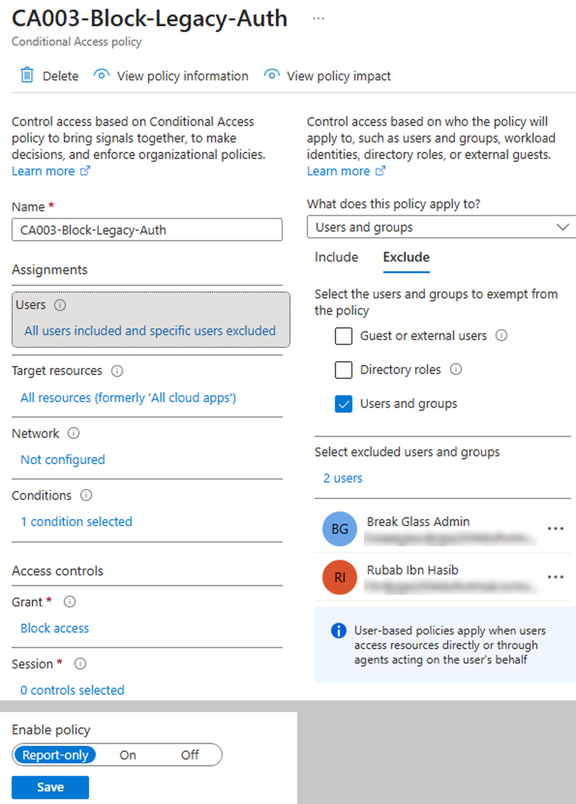

*Figure 14. CA003 from the template: all users included, Break Glass Admin excluded, Block access. The current-user exclusion seen here was removed before turning it On.*

The templates automatically excluded the current admin account. That exclusion was removed, because an excluded Global Admin is exactly the kind of gap auditors flag, and the admin account already uses MFA. Break Glass Admin holds Global Administrator, so CA002 was kept in Report-only until it was excluded.

In production, CA003 would run in Report-only for one to two weeks first, to catch old printers, scanners or apps still using legacy sign-in.

**Lab note:** during this step, the VMs briefly lost internet, and the Entra portal on DC01 showed blank policy pages until a fresh tab was opened. Conditional Access doesn't affect VM networking, so the two were unrelated.

### Step 22: Prove MFA is enforced

Signed in to myapps.microsoft.com as tuser2@wrathrock.com in an InPrivate window. Entra required MFA setup before access.

**Result in the sign-in log (12:31 PM):** Test User2, My Apps, Status **Success**, Conditional Access **Success**, Authentication requirement **Multifactor authentication**. Earlier sign-ins show *Not Applied*, because a sign-in is only checked against policies that were On at that moment. New sign-ins can take 5 to 15 minutes to appear in the log.

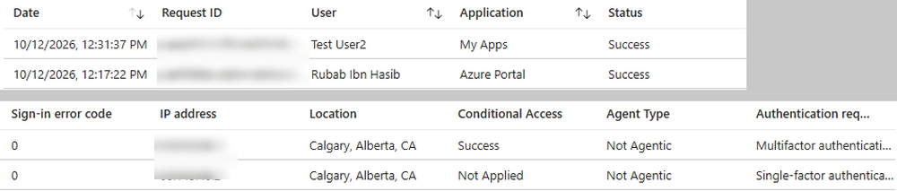

*Figure 15. Sign-in log row for Test User2 at 12:31 PM: My Apps, Success, Conditional Access **Success**, Multifactor authentication. The admin row below shows Not Applied, because admins aren't in the CA001 group.*

**Helpdesk issue on the way:** Microsoft Authenticator reported that the QR code was "already used". QR codes are single-use and expire quickly, and a dropped connection or page refresh during setup can use one up. Fix: generate a new code (Back, then Next), or as admin go to **Users**, then the user, then **Authentication methods**, delete the stale method and click **Require re-register multifactor authentication**. That's the same steps used when a user replaces a lost phone.


## Part 6: Lifecycle test

### Step 23: Joiner, a new user on-prem

Created `tuser3@wrathrock.com` in the CloudSync OU and waited for the scheduled sync, with no manual sync.

| Event | Local time | UTC |
| --- | --- | --- |
| Previous sync | 12:38 PM | 6:38 PM |
| tuser3 created on DC01 | 12:49 PM | 6:49 PM |
| Next scheduled sync | 1:08 PM | 7:08 PM |
| tuser3 visible in Entra | about 1:10 PM | about 7:10 PM |

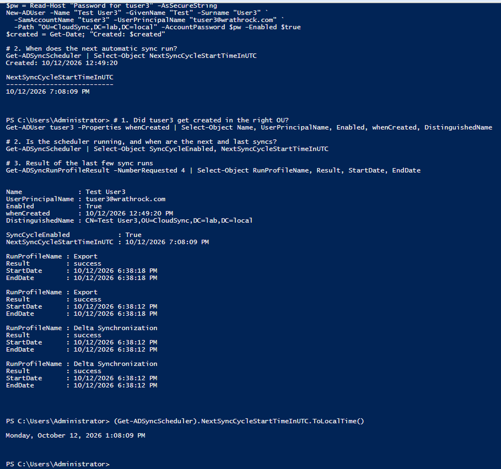

*Figure 16. Joiner test. tuser3 created at 12:49:20 in OU=CloudSync. The scheduler times are in UTC (7:08 PM UTC is 1:08 PM Calgary, shown by the last command), and the run history shows the Delta Synchronization and Export that carried tuser3 to Entra.*

**Result: about 20 minutes from creation to cloud.** With the default 30-minute cycle, a new hire can wait up to 30 minutes. For an urgent start, the helpdesk runs `Start-ADSyncSyncCycle -PolicyType Delta`.

Entra Connect logs in **UTC**, which is why scheduler times look 6 hours ahead of Calgary time during daylight saving. To convert: `(Get-ADSyncScheduler).NextSyncCycleStartTimeInUTC.ToLocalTime()`

The same sync can be run by hand in **Synchronization Service Manager**, under **Connectors**: lab.local **Delta Import**, then lab.local **Delta Synchronization**, then the AAD connector **Export**. Only use **Run** there, never connector **Properties**.

### Step 24: Leaver, disable on-prem

```powershell
Disable-ADAccount -Identity tuser3
Start-ADSyncSyncCycle -PolicyType Delta
```

**Result:** a few minutes later, a new sign-in as tuser3@wrathrock.com was **blocked**. Microsoft shows *"Your account has been locked"* for disabled accounts too, so users can't tell whether an account exists. The sign-in log records it as error **50057**, user account is disabled.

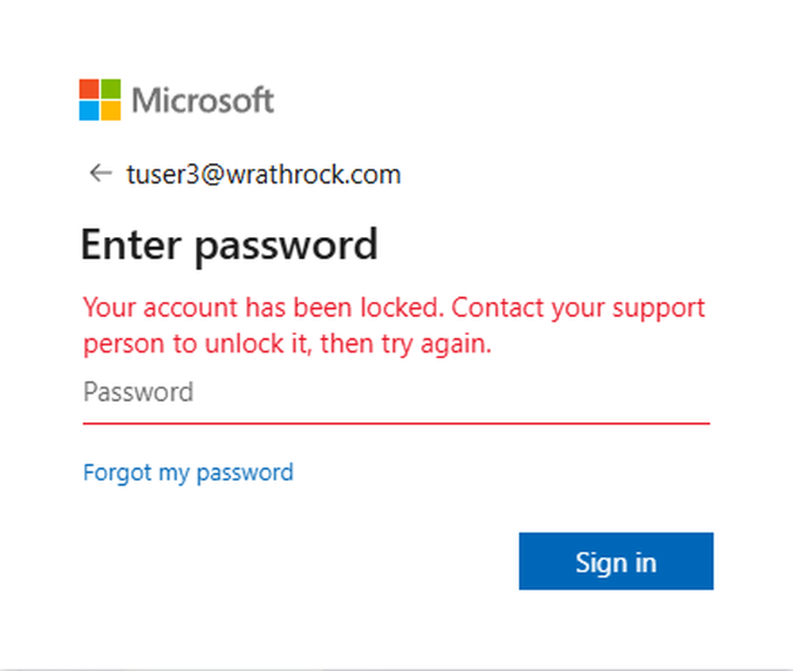

*Figure 17. Leaver test. After Disable-ADAccount and a sync, tuser3 can't sign in. Microsoft words a disabled account as "locked".*

**Known gap, not tested here:** disabling an account stops *new* sign-ins only. A browser or app that already holds a session token can keep working until that token expires, which can take an hour or more. Proper offboarding also clicks **Revoke sessions** on the user in Entra, or runs `Revoke-MgUserSignInSession`, straight after disabling. The existing-session part of this test was skipped in the lab and is documented as a known risk.


## Part 7: Clean-up

### Step 25: Remove DC01's accidental Entra registration

DC01 was **Entra registered** after an admin signed in to Edge and accepted *"Allow my organization to manage this device"*. That registration type is meant for personal and BYOD devices. A domain controller is Tier 0, can't be hybrid joined, and shouldn't be tied to an admin's cloud account.

Windows Server's Settings app showed the work account but offered no Disconnect option, so it was removed from the command line:

```powershell
dsregcmd /cleanupaccounts
dsregcmd /status | Select-String "WorkplaceJoined"   # expect NO
```

Then the DC01 device object was deleted under **Entra**, **Devices**, **All devices**.

**Side effect:** DC01's Edge profile was tied to the removed account, so the portal looped back to the password page. Fix: use an InPrivate window, or a separate admin workstation. Doing admin work from a domain controller's browser is poor practice anyway.

**Passkey prompt:** Entra then showed a "Passkey not registered" page. That's a **registration campaign** nudge, not a requirement. **Try again later** skips it. Turning the campaign off would not turn off MFA, because MFA is enforced by Conditional Access policies CA001 and CA002.


## Part 8: Single sign-on (SSO) to an app

### What SSO is

Single sign-on means a user signs in **once**, and every connected app lets them in without asking for another password. Instead of each app keeping its own usernames and passwords, the app **trusts Entra ID** to say who the user is.

### Why companies use it

| Without SSO | With SSO |
| --- | --- |
| A separate password for every app, so people reuse weak ones | One identity, protected by MFA and Conditional Access |
| When someone leaves, IT must remove them from every app one by one | Disable the account once, and access to every SSO app stops |
| Each app has its own sign-in rules | Every app gets the same MFA and device rules from Entra |
| No central record of who used what | Every sign-in appears in Entra's sign-in logs |

This is why SSO ties the whole lab together. The hybrid identity from Parts 3 and 4, the MFA policies from Part 5, and the offboarding from Part 6 all automatically apply to any app connected this way.

### How it works, in plain words (SAML)

SAML is one of the standard "languages" apps and identity providers use to trust each other.

1. The user opens the app.
2. The app doesn't check a password. It sends the user to Entra.
3. Entra signs the user in, applying MFA and Conditional Access, then sends back a **digitally signed message** that says, in effect, "this is tuser1, verified."
4. The app checks Entra's signature with a certificate it was given during setup, and lets the user in.

The app and Entra are set up to trust each other once, with matching URLs and a certificate. After that, no passwords pass between them.

### Why the Microsoft Entra SAML Toolkit

It's a free test app Microsoft provides for practising SAML SSO. It behaves like a real company app such as Salesforce or ServiceNow, but needs no paid account. The steps are the same as for a real app.

### Step 26: Add the app and assign a user

1. **Entra**, then **Enterprise apps**, then **New application**, search **Microsoft Entra SAML Toolkit**, then **Create**.
2. **Users and groups**, then **Add user/group**, choose **Test User1**, then **Assign**.

**Why assign users:** only assigned users see the app tile in My Apps and are allowed to sign in. That's least privilege again: access is granted per app, on purpose, rather than to everyone. In production you'd assign a group, such as "Sales-App-Users", not individual people.

### Step 27: Configure SAML single sign-on on the app

**What we're doing:** telling Entra and the app how to trust each other. Entra is the *identity provider* (it checks who you are). The SAML Toolkit is the *service provider* (it trusts what Entra says). They never share your password. Entra hands the app a signed note (the SAML token) saying "this is tuser1, I've checked them", and the app believes it because the signature matches Entra's certificate.

**Where:** Entra admin center > Enterprise apps > Microsoft Entra SAML Toolkit > **Single sign-on** > **SAML** > **Basic SAML Configuration** > Edit.

| Setting | Value | What it's for |
| --- | --- | --- |
| Identifier (Entity ID) | `https://samltoolkit.azurewebsites.net` | The app's unique name. Entra puts it in the token so the app knows the token was made for it, and no other app can reuse it |
| Reply URL (ACS URL) | `https://samltoolkit.azurewebsites.net/SAML/Consume` | Where Entra sends the signed token after you sign in. Entra only posts to URLs listed here, so a fake site can't receive your token |
| Sign on URL | `https://samltoolkit.azurewebsites.net/` | Where the My Apps tile sends you. The app then redirects you to Entra to sign in (SP-initiated sign-in) |

Click **Save**.

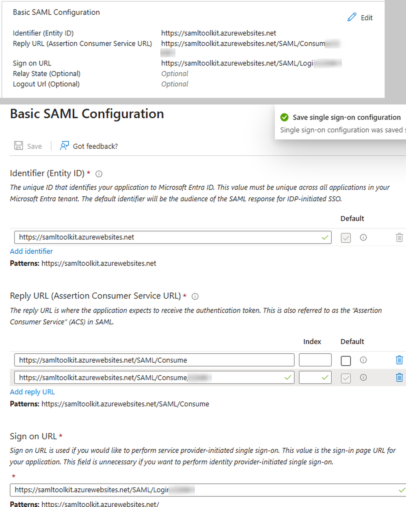

*Figure 18. Final Basic SAML Configuration (after the link-up below). Top: the saved summary. Bottom: the edit panel with the /Consume/<connection-id> Reply URL ticked as Default and the /Login/<connection-id> Sign on URL. The old generic /SAML/Consume line is left but not default.*

**Section 3, SAML Certificates:** Entra creates a signing certificate automatically. It signs every token, and the app checks that signature with the public part of the certificate. Note the expiry date (3 years by default). When it expires, sign-in to the app breaks, which is a common real-world outage.

**Section 4, Set up the app:** copy the **Login URL** and the **Microsoft Entra Identifier**. The app needs these to know where to send users to sign in and which identity provider to trust.

**Then, on the toolkit site:** go to `https://samltoolkit.azurewebsites.net`, register a local account there (any email and password; this is only the toolkit's own login), open **SAML Configuration** > **Create**, paste the Login URL and Entra Identifier, and upload the **Certificate (Base64)** downloaded from section 3. This is the app side of the trust: now the app knows Entra's address and signature.

**Correction while building:** the toolkit form asks for **Certificate (Raw)**, not Base64. Its three URL boxes take Entra's values from section 4 (Login URL, Entra Identifier, Logout URL), not the app's own addresses. A common mistake is pasting the Reply URL into all three, which makes the app send users back to itself instead of to Entra.

**Final link-up:** after you click Create, the toolkit gives your configuration its own number (in this lab, <connection-id>) and shows two personal URLs. Go back to Entra > Basic SAML Configuration and replace the generic ones:

- Reply URL: `https://samltoolkit.azurewebsites.net/SAML/Consume/<connection-id>`
- Sign on URL: `https://samltoolkit.azurewebsites.net/SAML/Login/<connection-id>`

**Why:** the toolkit is shared by many testers. The number tells it which configuration, and so which trusted certificate, to check the incoming token against. Real SaaS apps do the same with a per-customer tenant ID or subdomain in the URL.

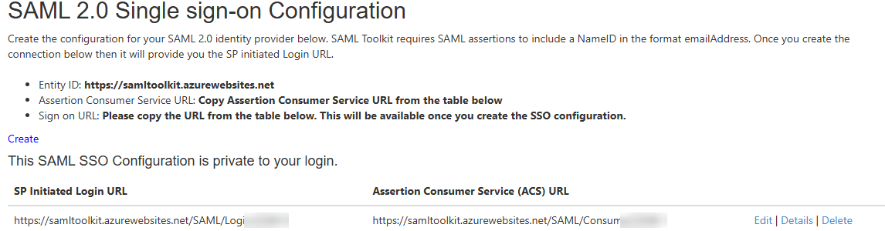

*Figure 19. The toolkit after Create: configuration <connection-id> with its SP-initiated Login URL and ACS URL. These two URLs are what went back into Entra.*

### Step 28: Test SSO

1. Sign in to Workstation01 as **LAB\\tuser1**.
2. Open Edge and go to `myapps.microsoft.com`. Because of the PRT from hybrid join, you should land there without typing a password.
3. Click the **Microsoft Entra SAML Toolkit** tile.

**Expected:** the toolkit opens signed in as tuser1@wrathrock.com, with no password prompt. The toolkit page lists the claims it received from Entra (name, email), which proves the token arrived and was trusted.

**Result: passed.** On Workstation01 as LAB\\tuser1, the My Apps tile opened the toolkit's Login page. Clicking **Log in** landed straight on the toolkit home page showing "Hello tuser1@wrathrock.com!", with no password and no visible stop at Entra. The trip to Entra did happen, but so fast it's invisible: Edge presented the PRT from hybrid join, Entra issued the signed SAML token silently, and the browser posted it back to the toolkit. The toolkit account was registered on DC01, never on Workstation01, so the only way it could know who tuser1 is here is the SAML token. The Entra sign-in logs (filter by application: Microsoft Entra SAML Toolkit) show the record of that hidden round trip.

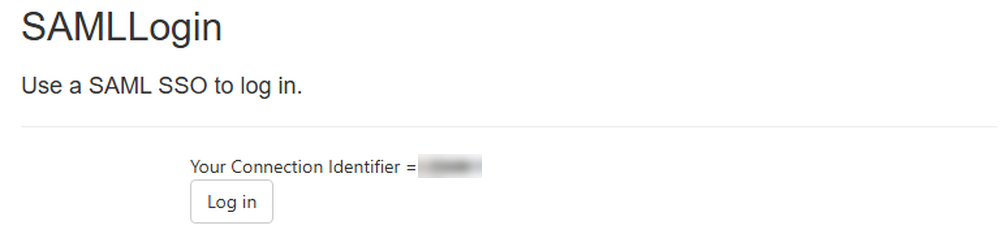

*Figure 20. Where the My Apps tile lands. The Log in button under the identifier starts the SAML sign-in.*

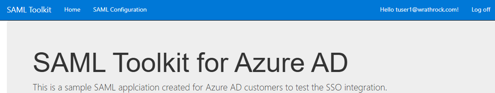

*Figure 21. The result: "Hello tuser1@wrathrock.com!" in the top bar, with no password typed.*

**Log evidence:** Enterprise apps > Microsoft Entra SAML Toolkit > Activity > Sign-in logs, **User sign-ins (interactive)** tab: 2026-10-12T20:01:05Z (2:01 PM Calgary), tuser1@wrathrock.com, Status Success, Conditional Access Success, location Calgary. It appears under *interactive* even though no prompt was shown, because it was the first sign-in to this app; the PRT simply answered the challenge for the user. The log took a few minutes to appear.

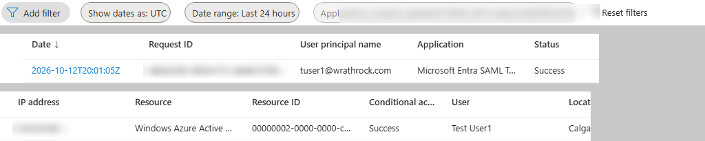

*Figure 22. Sign-in log for the app (dates in UTC). Row split in two for readability: 20:01:05Z, tuser1@wrathrock.com, Microsoft Entra SAML Toolkit, Success; then Conditional access Success, user Test User1, location Calgary.*

**Why this matters:** one sign-in to Windows now gives access to cloud apps. Users have fewer passwords to reuse or phish, and disabling the user in AD (the leaver test) removes access to every connected app at once.

**Evidence to keep:** screenshot of the Basic SAML Configuration and the toolkit page showing the received claims.


## Part 9: Join LNX01 (Ubuntu) to lab.local

**Why:** one identity for Windows and Linux. After the join, AD users such as tuser1 sign in to LNX01 with their lab.local password, and disabling them in AD locks them out of Linux too. That's the same joiner and leaver control as Part 6, extended to Linux. It does **not** make LNX01 appear in Entra (see the note at the end of this part).

**Starting point:** `realm list` returned "command not found" and `id tuser1@lab.local` returned "no such user". LNX01 had never been joined; the join log later confirmed no LNX01$ account existed.

### Step 29: Work over SSH so commands can be pasted

The VMware console for a text-only Ubuntu server doesn't support paste. SSH from DC01 does.

```bash
sudo apt update
sudo apt install -y open-vm-tools openssh-server
sudo systemctl enable --now ssh
ip -4 addr show | grep inet    # LNX01 = 10.10.20.101
```

Then on DC01, in **Windows Terminal** (not PowerShell ISE, which can't run interactive programs like ssh and just hangs): `ssh rubab@10.10.20.101`.

### Step 30: Install the join tools

```bash
sudo DEBIAN_FRONTEND=noninteractive apt install -y realmd sssd sssd-tools libnss-sss libpam-sss adcli samba-common-bin oddjob oddjob-mkhomedir packagekit krb5-user
```

| Package | What it does |
| --- | --- |
| realmd | Runs the join and sets everything up |
| sssd | Checks AD usernames and passwords on Linux and caches them |
| adcli | Creates the computer account in AD |
| krb5-user | Kerberos, the sign-in protocol AD uses |
| oddjob-mkhomedir | Creates a home folder the first time an AD user signs in |

### Step 31: Point LNX01's DNS at DC01

**Problem:** `realm discover lab.local` said "No such realm found". LNX01 got its DNS from DHCP: 10.10.20.1, which is pfSense. pfSense doesn't know about lab.local; only DC01 does. Windows domain members always use the DC for DNS, and Linux members need the same.

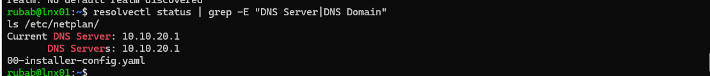

*Figure 23. Before the fix, LNX01's DNS server is 10.10.20.1, which is pfSense, and it doesn't know lab.local. DC01 is 10.10.10.10.*

```bash
sudo tee /etc/netplan/99-lab-dns.yaml > /dev/null <<'EOF'
network:
  version: 2
  ethernets:
    ens33:
      dhcp4: true
      dhcp4-overrides:
        use-dns: false
      dhcp6-overrides:
        use-dns: false
      nameservers:
        addresses: [10.10.10.10]
        search: [lab.local]
EOF
sudo chmod 600 /etc/netplan/99-lab-dns.yaml
sudo netplan apply
```

This keeps the DHCP address but ignores DHCP's DNS server and uses DC01 instead. It goes in a separate 99- file so the installer's file is untouched. Netplan requires the same use-dns value for IPv4 and IPv6; the first attempt left out dhcp6-overrides and failed with that error.

### Step 32: Allow LNX01 through the pfSense DMZ rule

**Problem:** with DNS fixed, lookups still timed out, and ports 53, 88, 389 and 445 on 10.10.10.10 all timed out. LNX01 sits on OPT1, which is a DMZ. A rule there, **Block and log DMZ to LAN**, blocks the DMZ from reaching the internal network, and its counter showed the blocked traffic. That's correct design: a DMZ host shouldn't reach the internal network by default.

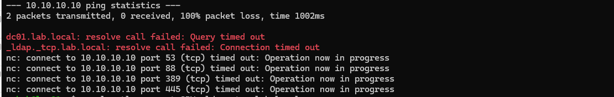

*Figure 24. With DNS pointed at DC01, everything to 10.10.10.10 times out: ping, DNS lookups and every AD port. A timeout rather than a refusal means something in the path is dropping the traffic.*

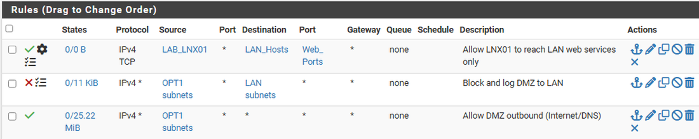

*Figure 25. OPT1 rules before the fix. "Block and log DMZ to LAN" shows 11 KiB of blocked traffic, which is LNX01's attempts to reach DC01.*

**Fix: one narrow exception, not a hole.**

1. Firewall > Aliases > Ports: alias **AD\_Ports** = 53 (DNS), 88 (Kerberos), 123 (time), 389 (LDAP), 464 (Kerberos password change), 445 (SMB), 636 (LDAP over SSL), 3268 and 3269 (Global Catalog).
2. Firewall > Rules > OPT1, using the Add button with the up arrow so it goes at the top: Pass, **TCP/UDP**, source **LAB\_LNX01**, destination **10.10.10.10**, port **AD\_Ports**, description "Allow LNX01 to DC01 for AD domain join".

**Why it must be TCP/UDP:** DNS, time and parts of Kerberos use UDP. **Why at the top:** pfSense stops at the first rule that matches, so a pass rule below the block rule would never be reached. Ping still fails afterwards, and that's intentional: only the AD ports are open.

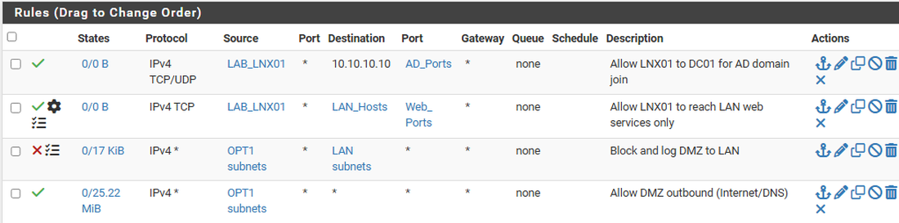

*Figure 26. OPT1 rules after the fix. The new pass rule (LAB\_LNX01 to 10.10.10.10, TCP/UDP, AD\_Ports) sits above the block rule. The block rule still covers everything else from the DMZ.*

**Result:** `resolvectl query -t SRV _ldap._tcp.lab.local` returned `dc01.lab.local` on port 389, and `realm discover lab.local` showed `server-software: active-directory`.

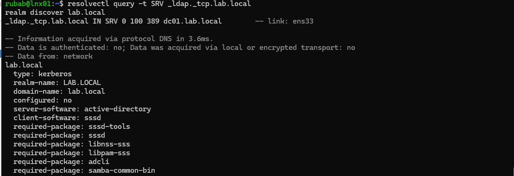

*Figure 27. After the rule: the SRV record finds dc01.lab.local, and realm discover identifies an Active Directory domain that isn't joined yet (configured: no).*

### Step 33: Join the domain

```bash
sudo realm join -U Administrator lab.local --verbose
```

**What happened** (from the verbose log): adcli created **CN=LNX01,CN=Computers,DC=lab,DC=local**, set a 120-character machine password with Kerberos, saved the machine keys to `/etc/krb5.keytab`, then enabled and restarted sssd. The last line: **Successfully enrolled machine in realm**. The keytab is Linux's version of a Windows computer account password; it's how LNX01 proves its identity to DC01.

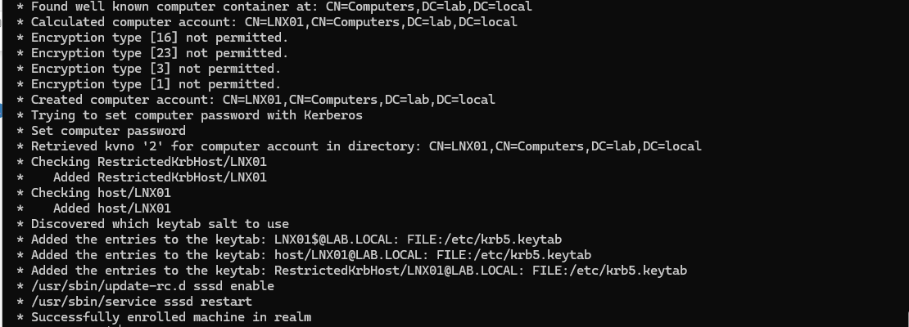

*Figure 28. The join log: the computer account is created in CN=Computers, the password is set with Kerberos, keys are added to /etc/krb5.keytab, sssd is restarted, and the last line reads "Successfully enrolled machine in realm".*

**Note:** the log lists some encryption types as "not permitted". Those are old, weak ones (DES and RC4) that AD refuses by default, so it's a good sign rather than an error.

### Step 34: Create home folders and verify AD users

```bash
sudo pam-auth-update --enable mkhomedir
realm list
id tuser1@lab.local
getent passwd tuser1@lab.local
```

**Why mkhomedir:** an AD user has no folder on LNX01 until their first sign-in. Without this setting, the login would land in a folder that doesn't exist and fail.

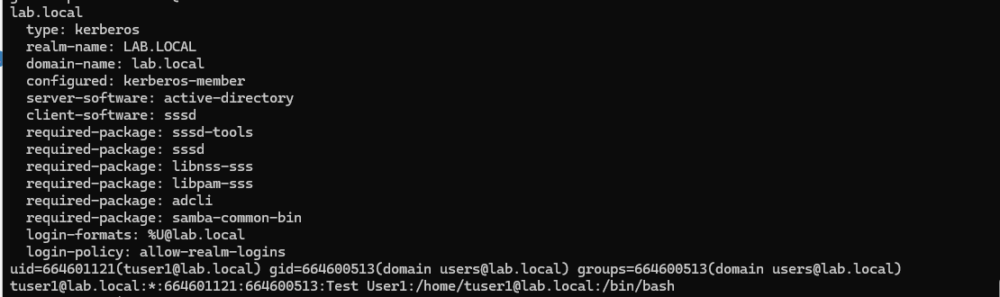

*Figure 29. realm list now shows configured: kerberos-member. id maps tuser1 to a Linux user ID with the AD group "domain users". getent shows the display name "Test User1" and the home folder /home/tuser1@lab.local, both coming from AD.*

### Step 35: Sign in as tuser1, and fix the GPO access check

The first `ssh tuser1@lab.local@10.10.20.101` ended with "Connection closed" straight after the password. auth.log showed why:

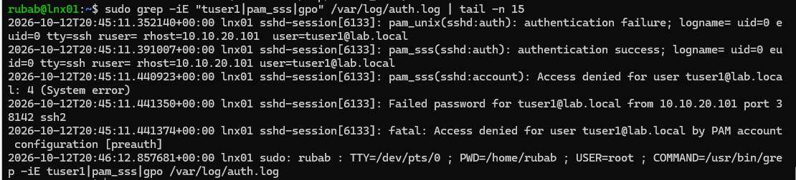

*Figure 30. Two separate checks. `pam_sss(sshd:auth): authentication success` means AD accepted the password. `pam_sss(sshd:account): Access denied ... 4 (System error)` means the next check, whether this user may log on to this machine, failed.*

**Cause:** sssd's **GPO access control**. By default (enforcing), sssd reads the domain's Group Policy logon rights, such as "Allow log on locally", and applies them on Linux. It couldn't complete that check, so it denied the login to be safe.

**Fix (lab):**

```bash
sudo sed -i '/^\[domain\/lab.local\]/a ad_gpo_access_control = permissive' /etc/sssd/sssd.conf
sudo sss_cache -E
sudo systemctl restart sssd
```

"Permissive" means sssd still evaluates the GPO and logs what it *would* deny, but doesn't block. `sss_cache -E` clears the cached "deny" so the change takes effect immediately.

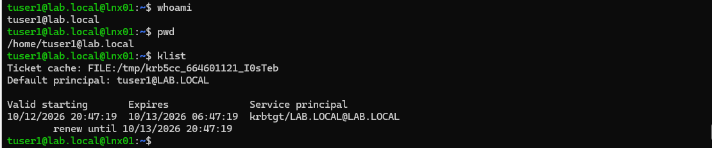

*Figure 31. Signed in to LNX01 as tuser1. whoami shows tuser1@lab.local, the home folder was created automatically, and klist shows a Kerberos ticket (krbtgt/LAB.LOCAL) issued by DC01, valid for 10 hours and renewable for a day.*

**Production trade-off:** permissive weakens a control. In production you'd keep it enforcing and grant the logon right through GPO, then limit who can sign in to Linux servers to a group, for example `sudo realm deny --all` followed by `sudo realm permit -g linux-admins@lab.local`. That gives least privilege: being in the domain no longer means you can log on to every Linux server.

**Result: Part 9 passed.** LNX01 is a domain member, AD users sign in with their AD password, and DC01 issues their Kerberos tickets through a firewall exception limited to AD ports only.

**Why LNX01 won't appear in Entra Devices (and that's expected):** LNX01 is joined to lab.local, but moving its computer object into the CloudSync OU won't make it show up in Entra. Entra Connect only turns *Windows* computer objects into hybrid joined devices, because hybrid join depends on Windows itself registering with Entra using the SCP and a device certificate (Steps 11 to 13). Linux has no hybrid join client, so Entra Connect skips Linux computer objects even when they're in scope. That's why LNX01 stays in its current OU: being in CloudSync would add nothing and widen the sync scope for no reason.

What LNX01's domain join *does* give: one set of AD accounts for Windows and Linux. tuser1 can SSH or log on to LNX01 with the same lab.local password, and access can be limited by AD group. Check it with `realm list` (should show lab.local, configured: kerberos-member) and `id tuser1@lab.local` (should list the user's AD groups).

**If Linux does need to be in Entra:** the supported routes are Intune enrolment for Ubuntu Desktop (shows as a Microsoft Entra registered device), or Azure Arc for servers, which projects the machine into Azure and allows Entra ID sign-in over SSH. Both are separate from Entra Connect and are a good fit for a later lab, not this one.


---

Design reasoning for every major choice is in [`adr/`](adr/).
